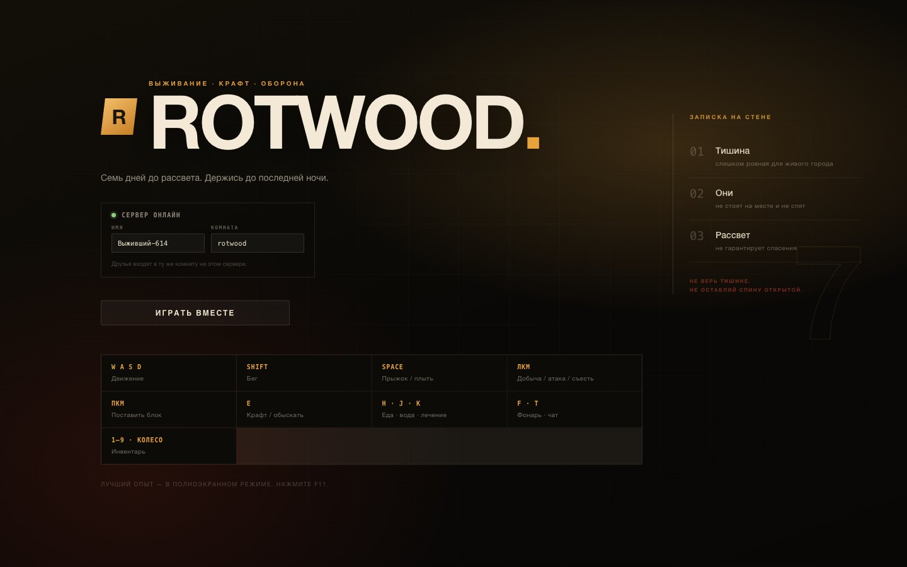
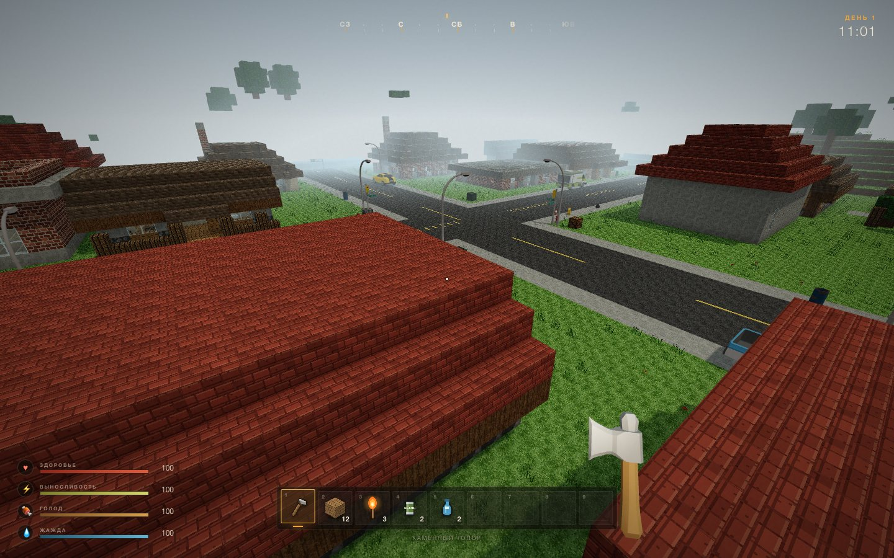
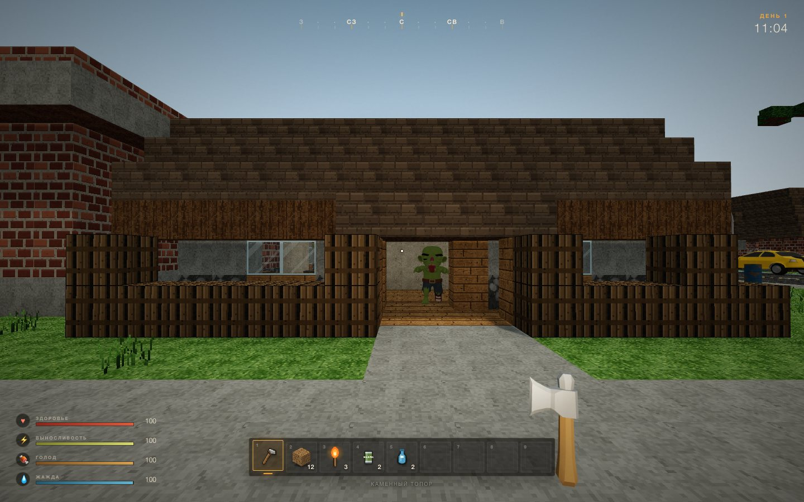
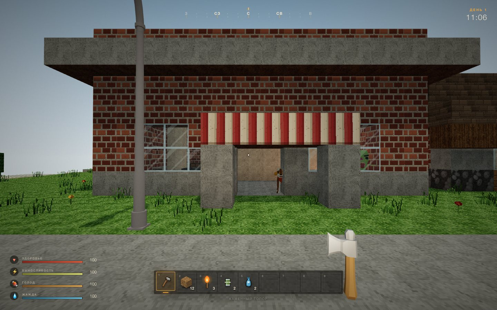
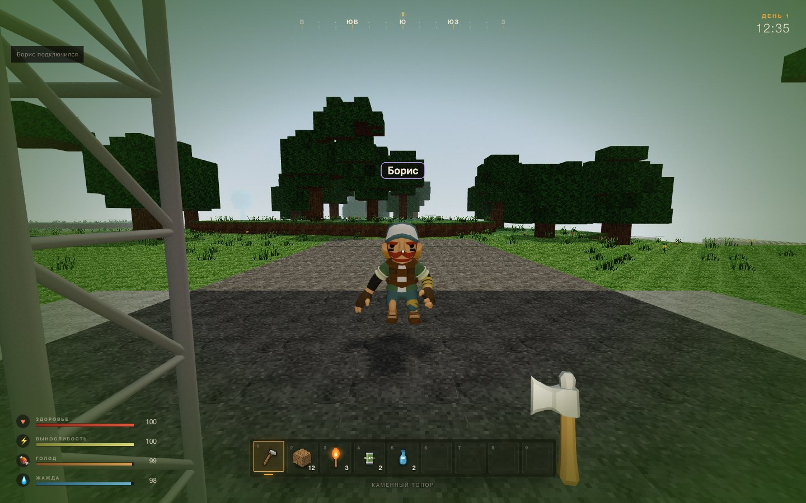
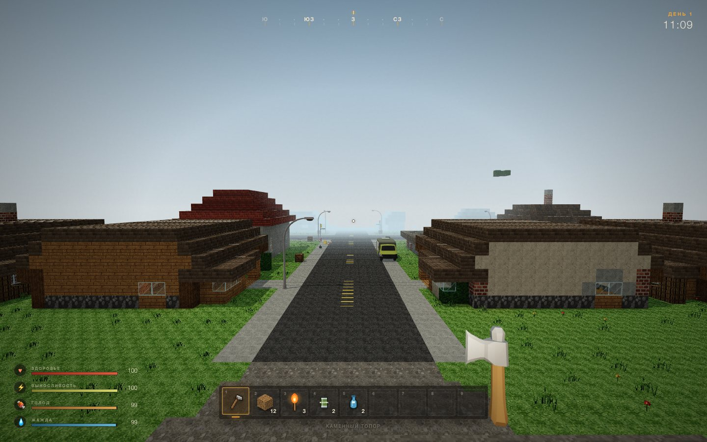
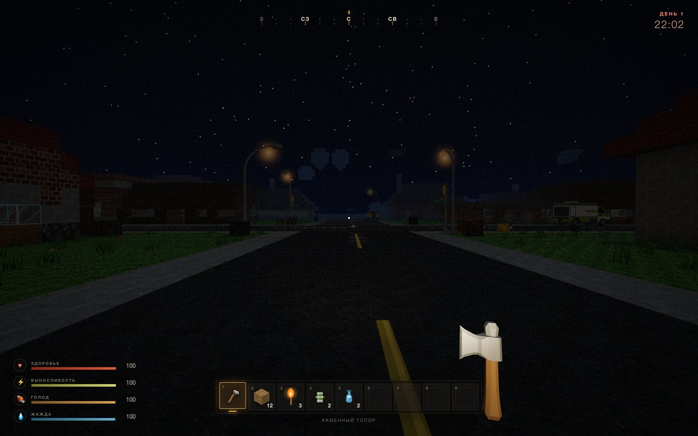
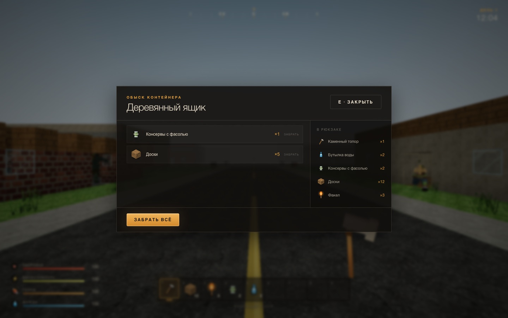
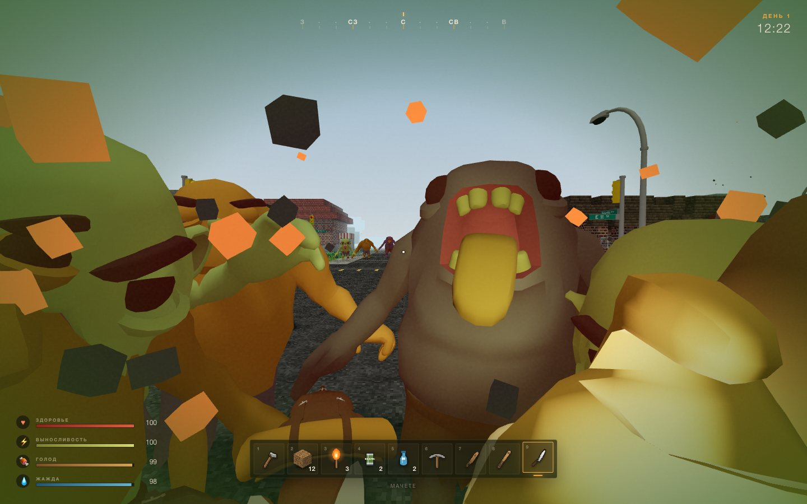

# ROTWOOD — 7 дней до рассвета

Браузерная voxel-survival игра в духе **7 Days to Die**, сделанная на Three.js + TypeScript + Vite. Мир, текстуры, звук и иконки генерируются процедурно; из внешних ассетов — только CC0-модели Quaternius (зомби, выжившие, оружие, городской реквизит и машины).



## Запуск

```bash
npm install
npm run dev
# http://localhost:5180
```

Сборка и предпросмотр production-версии:

```bash
npm run build
PORT=8080 npm start
# http://localhost:8080
```

`npm start` запускает один сервер, который отдаёт собранный `dist` и WebSocket на одном порту. Без `PORT` он слушает `5190`. Для App Platform и Docker-образа используется порт `8080`.

Нужен современный десктопный браузер с WebGL2 (Chrome, Edge, Firefox, Safari 17+). Для игры мышью браузер запросит pointer lock после кнопки «Войти в мир».

## Мультиплеер

`npm run dev` поднимает сразу Vite и игровой WS-сервер на `:5190`. В меню задайте имя и комнату — друзья входят в ту же комнату на этом сервере (комнату можно передать ссылкой `?room=имя`).

- Синхронизируются игроки, их модели и анимации, никнеймы, правки блоков, обысканные контейнеры, убитые POI-зомби, убитые уличные зомби и прогресс зачистки зданий, а также время суток.
- Чат — клавиша `T`, `Enter` — отправить, `Esc` — закрыть.
- Ночные бродяги спавнятся и атакуют локально у каждого клиента; их разрушения блоков синхронизируются. Жильцы зданий (POI) и уличная орда общие: если один игрок убил зомби, у остальных он исчезает и больше не возвращается — город можно зачистить для всей комнаты.
- Если сервер не запущен, игра автоматически стартует в одиночном режиме. Только одиночная игра: `npm run dev:web`.
- Production: `npm run build`, затем `PORT=8080 npm start` (статика и WebSocket на одном порту). Для App Platform — готовый `Dockerfile`.
- Состояние комнат (сид, правки, лут, POI, время) сохраняется в `server/rooms.json`.

## Развитие персонажа

Опыт даётся за убийство зомби, добычу блоков, обыск контейнеров и машин, крафт и полную зачистку здания. Каждый новый уровень приносит **1 очко навыка** (окно `P`).

- **Ближний бой** (топор, кирка, дубина, бита, мачете): качайте **силу** — каждое очко даёт +2% урона — и перк **«Мясник»** (+12% за уровень).
- **Огнестрел и лук**: качайте **восприятие** (+2% урона за очко) и перк **«Стрелок»** (+12% за уровень).
- **Выживаемость**: выносливость → больше здоровья и перк «Крепкий»; «Железный желудок» замедляет голод и жажду.
- **Добыча и лут**: сила → «Шахтёр» (+10% скорости добычи), восприятие → «Мародёр» (+10% шанса дополнительной добычи).
- **Мобильность и скрытность**: ловкость → «Бегун» (+6% скорости бега) и «Тихоход» (зомби замечают на 7% ближе).
- **Медицина**: интеллект → «Медик» (+20% к лечению), а сам интеллект ускоряет набор опыта.

Сначала поднимите атрибут до требования перка (например, «Мясник» требует силу 1, «Тихоход» — ловкость 3), затем вкладывайте очки в перк. Сброса очков нет, поэтому выбирайте специализацию под свой стиль: ближний бой, стрельба или скрытность.

## Деплой на Timeweb App Platform

Да, проект подготовлен под App Platform: в корне лежит `Dockerfile`, а `server/index.mjs` умеет отдавать собранный фронтенд и WebSocket **на одном порту** (`8080`). В production клиент подключается к тому же origin, поэтому работает `wss://` через автоматический SSL Timeweb.

Порядок:

1. Запушьте проект в GitHub/GitLab/Bitbucket (или подключите репозиторий по URL). В проекте уже есть `.dockerignore`, тяжёлые `node_modules` и `dist` в образ не попадут.
2. App Platform → «Создать» → выберите репозиторий.
3. Тип приложения — **Dockerfile**, путь к Dockerfile — корень репозитория.
4. Порт `8080` уже указан через `EXPOSE` в Dockerfile, health-check — `/health`.
5. Запустите деплой. Технический домен и SSL Let's Encrypt выдаются автоматически; свой домен можно привязать позже.

Особенности App Platform:

- Внутри контейнера **нет постоянного диска**. `server/rooms.json` живёт до пересоздания контейнера/редеплоя. Для постоянного хранения комнат нужен внешний S3/БД (могу подключить) либо обычный VPS с volume.
- Запускайте **один инстанс**: комнаты и WebSocket-сессии хранятся в памяти процесса, горизонтальное масштабирование без общего хранилища не подойдёт.
- WebSocket идёт через тот же Caddy и тот же порт; отдельная настройка не требуется.
- Переменные окружения не обязательны: `PORT=8080` задан в Dockerfile. При необходимости можно переопределить `PORT`, `ROOMS_FILE`, `DAY_LENGTH` (длина суток в секундах, по умолчанию `1800`).
- **Health-check.** Платформа опрашивает `http://localhost:8080/health` изнутри контейнера. Сервер слушает dual-stack (`::`, принимает и `127.0.0.1`, и `::1`), отвечает с явным `Content-Length` и пишет в лог строку `[health] GET /health ... -> 200`. В образ установлен `curl` — некоторые проверяющие используют его. Если health всё равно не проходит, в настройках приложения можно временно **очистить поле «Путь проверки состояния»**: платформа будет проверять только факт запуска контейнера, а приложение продолжит работать.

## Что уже реализовано

### Мир
- Бесконечный процедурный воксельный мир по сиду: чанки 16×16×96, подгрузка и выгрузка на лету.
- Рельеф с равнинами, пляжами, горами, снежными вершинами, озёрами и океаном.
- **Процедурные города:** асфальтовые улицы с разметкой и тротуарами, 11–16 зданий — дома, магазины, аптеки, полиция, склады, заправки, руины и **многоэтажки**. Дома с двускатными крышами, крыльцами, эркерами, заборами, трубами и дворами; у магазинов — витрины и полосатые навесы. Часть домов, магазинов и складов имеет **2 этажа**, многоэтажки — 3–5 этажей с междуэтажными лестницами-«змейками». Застройка каждый раз разная: дома стоят с отступами от улицы, пустые участки занимают машины, контейнеры и мусор, по улицам расставлены фонари, светофоры, гидранты, конусы, барьеры и водонапорная башня. Стартовый город гарантированно стоит впереди точки появления.
- **Плавный вход в город:** рельеф переходит в ровное плато через сглаженный пояс, дорога постепенно сменяется гравием, а вокруг города растёт лесополоса.
- Деревья с кроной, угольная и железная руда, гравий, коренная порода.
- Трава, цветы и мелкая растительность как декор.
- Цветная подсветка граней и ambient occlusion, тени от солнца, туман, градиентное небо.
- День/ночь с солнцем, луной, звёздами и циклом в **30 реальных минут** (настраивается через `DAY_LENGTH` на сервере).
- Вода с прозрачностью и подводным туманом, плавание.

### Города, лут и POI
- Внутри зданий — ящики, шкафы, сейфы, холодильники, мусорные баки и медицинские шкафы.
- Интерьеры обставлены импортированной мебелью: диваны, паллеты и бочки стоят вдоль стен и в углах.
- Обыск контейнера по `E`: по одному предмету или всё сразу. Во время лута мир **не встаёт на паузу**.
- **Обыск машин:** подойдите к пикапу, спорткару или грузовику и нажмите `E` — в салоне и багажнике есть инструменты, патроны, стрелы, медикаменты и иногда оружие.
- **Ловушки в домах:** на полу некоторых зданий стоят шипы. Они ранят и игрока, и зомби.
- Детерминированные таблицы лута: еда, вода, медикаменты, патроны, стрелы, деньги, инструменты, бита, мачете, лук и пистолет.
- Сломанный контейнер автоматически высыпает содержимое в рюкзак.
- **Зомби в зданиях предзаданы и ограничены:** у каждого дома свой счётчик жильцов, а зачищенное здание больше их не возрождает. Состояние POI и контейнеров сохраняется.
- **Зомби в городе и вокруг него — около 150 особей.** Часть живёт в зданиях, часть бродит по улицам и окраинам. Уличная орда и жильцы зданий имеют фиксированное население: убитые не возрождаются, поэтому со временем город можно зачистить полностью. Ночью новые бродяги появляются только в дикой местности, не внутри городов.
- Убитые зомби оставляют добычу: тряпки, патроны, деньги, еду и медикаменты.

### Босс: Матка гнили

- Каждые **два дня** после 21:00 выходит босс. В 20:15 появляется предупреждение.
- **Матка гнили**: огромная, зелёная, с запасом **1100 + 150×день** HP. Её удар убивает с **трёх попаданий** даже в полной броне.
- Каждый удар **отравляет** (9 секунд), рядом с ней действует ядовитая аура. Раз в ~12 секунд — **ядовитая нова** по площади, раз в 16 секунд — **призыв миньонов** (токсичные и бегуны).
- Ниже 35% HP **впадает в ярость**: ускоряется, бьёт чаще и светится красным.
- Награда: 700 опыта, аптечки, патроны 7.62, металлолом и бронежилет. Убить её можно только один раз за босс-ночь.

### Зомби и модели
- **6 импортированных анимированных glTF-моделей** из CC0-пака Quaternius (см. `CREDITS.md`): четыре зомби и две собаки. Клипы Idle / Walk / Run / Attack / HitReact / Death.
- Из них собрано **10 типов противников**: ходок, бегун, громила, однорукий, крикун, токсичный, элита, ползун, гончая и мопс.
- Громила отбрасывает игрока; токсичный травит и оставляет отравленное облако; крикун усиливает и подгоняет соседних зомби; ползун и собаки ниже, быстрее и труднее для попадания.
- Типы смешиваются по дню, ночи и типу здания. Ночью и в городах их становится заметно больше.
- **Зрение и слух:** зомби не бегут к игроку постоянно. Они замечают его в конусе зрения с проверкой линии видимости, слышат шаги, бег, удары, выстрелы и установку блоков. Услышав шум, идут проверять; увидев — преследуют; потеряв из виду — некоторое время ищут след. Если один зомби погнался за игроком, соседние подхватывают тревогу.
- **Никаких полос здоровья над мобами, счётчиков убийств, целей, подсказок о зомби или их количестве.** Только собственный HUD выживания, компас, часы, хотбар и руки.
- Внешний вид, размер, цвет и способности типа различаются; модели анимированы и поворачиваются к игроку.
- **Импортированные модели оружия:** деревянный топор со стальным лезвием, кирка, нож, пистолет и две биты. У каждого — своя модель в руке.
- **Импортированный городской реквизит:** уличные фонари, светофоры, гидранты, мусорные контейнеры, кресла, паллеты, барьеры, конусы, дорожные знаки и водонапорная башня.
- **Импортированные машины:** пикап, спорткар и грузовик; они паркуются вдоль улиц и на пустых участках.

### Игрок
- First-person контроллер с коллизиями AABB, прыжками, бегом и выносливостью.
- Автошаг на одну клетку вверх: подъём по склонам, ступеням и лестницам без постоянных прыжков.
- **Из воды можно выбраться без разрушения берега:** у воды есть запас плавучести и автошаг на блок.
- Назад и вбок персонаж двигается медленнее, чем вперёд; бег назад не даёт полной скорости.
- **Броня и бафы:** каска (+5% опыта), бронежилет (+8 HP), штаны (+5% скорости), берцы (−25% урона от падения). Полный комплект даёт +8% брони и уникальный «Адреналин»: ниже 35% HP — +15% урона. Броня снижает входящий урон (до 52% в полном сете), надевается и снимается кликом в инвентаре.
- **Голод и жажда:** еда и вода из лута теперь по-настоящему нужны.
- Урон от падения, отравление, регенерация здоровья, смерть и возрождение на точке спавна.
- Фонарь (F) включён по умолчанию, покачивание камеры, анимация предмета в руке.
- Добыча блоков с прогрессом и учётом инструмента, установка блоков.
- **Инвентарь в стиле Minecraft:** слева выживший и слоты брони (каска, бронежилет, штаны, берцы), в центре — сетка 3×9 и хотбар, справа — крафт. Инвентарь, хотбар и броня хранятся в `localStorage` (`rotwood.inventory.v1`) и переживают перезапуск, редеплой и перезаход в комнату.
- Оружие: топор, кирка, дубина, бита, мачете, стальные инструменты, **пистолет**, **лук** и **винтовка** (патроны 7.62).
- 38 блоков, включая городские материалы, мебель, контейнеры и шипы.

### Выживание и крафт
- Крафт: доски, палки, дубина, каменный топор, каменная кирка, факелы, бинты, **лук, стрелы, шипы, аптечка, стальной топор, стальная кирка, винтовка, патроны 7.62 и четыре предмета брони**.
- **Навыки и прокачка:** за убийства, добычу, лут, крафт и зачистку зданий дают опыт. Уровень даёт очко навыка. Пять атрибутов (сила, ловкость, выносливость, восприятие, интеллект) и девять перков: мясник, шахтёр, бегун, тихоход, крепкий, железный желудок, стрелок, мародёр и медик. Открываются клавишей `P`.
- Факелы — настоящий источник света: до 6 ближайших динамических PointLight с мерцанием; факелы есть и в зданиях.
- Ночные зомби преследуют игрока, бьют в ближнем бою; их число и состав растут с каждым днём.
- Зомби ломают блоки на пути: дерево и доски — быстро, камень — медленно. Стены больше не гарантируют безопасность.
- На рассвете ночные зомби загораются и погибают.
- HUD без подсказок: здоровье, выносливость, голод, жажда, компас, часы, день и хотбар.
- Пауза, настройки чувствительности, громкости, дальности прорисовки и качества графики. `Esc` в инвентаре сначала закрывает инвентарь, и только следующее нажатие ставит игру на паузу.
- Автосохранение в `localStorage` (мир, постройки, инвентарь, время, позиция, голод/жажда, POI, лут и прокачка).

### Оптимизация

- **LOD зомби:** полная анимация вблизи, 10 Гц вдали, за пределами 56 блоков (38 на низкой графике) модели скрываются и не анимируются; ИИ дальних зомби обновляется реже.
- Зомби больше не отбрасывают тени и отсекаются по пирамиде видимости; одновременно активно не больше ~40 жильцов POI.
- Тени солнца обновляются 4 раза в секунду, карта теней 1024 (2048 на высокой графике), тени можно полностью отключить.
- **Адаптивное разрешение:** при просадках ниже ~38 FPS движок сам понижает pixel ratio (до 0.7), при запасе — возвращает.
- HUD обновляет DOM только при изменении значений, а не каждый кадр.
- В паузе появилась настройка **«Графика»**: низкая (без теней, дальность 4 чанка, 3 факельных источника), средняя, высокая.

### Атмосфера
- **Реальные CC0-звуки** с Freesound (см. `CREDITS.md`): шаги по траве и земле, вода, рубка дерева, камень, удары, боль, выстрел, лук, стоны, крики и смерть зомби, толпа зомби, ветер днём и ночью, сверчки, сердцебиение, интерфейс. Если сэмпл не загрузился — звук синтезируется процедурно.
- Приглушённая палитра, плотный туман, тёмные ночи, виньетка и зерно — мрачная атмосфера.
- Ночное небо со звёздами, луна, тёплый свет факелов.
- Полноценное меню, экран загрузки, экран смерти.

## Управление

| Клавиши | Действие |
| --- | --- |
| `W A S D` | движение |
| `Shift` | бег (вперёд) |
| `Space` | прыжок / плыть вверх |
| ЛКМ | добыча / удар / выстрел |
| ПКМ | поставить блок |
| `E` | обыскать контейнер или машину / открыть крафт |
| `I` или `Tab` | инвентарь и крафт |
| `P` | навыки и прокачка |
| `1`–`9`, колесо | выбор слота |
| `F` | фонарь |
| `H` / `J` / `K` | быстрое лечение / еда / вода |
| `T` | чат |
| `Esc` | закрыть окно, затем пауза |










## Управление

| Клавиша | Действие |
| --- | --- |
| WASD | Движение |
| Shift | Бег |
| Space | Прыжок / плыть вверх |
| ЛКМ | Добыча / атака / стрельба / съесть выбранный предмет |
| ПКМ | Поставить блок |
| 1–9, колесо | Выбор слота |
| E | Крафт / обыскать контейнер |
| H | Съесть еду из рюкзака |
| J | Выпить воду |
| K | Использовать медикаменты |
| F | Фонарь |
| T | Чат |
| Esc | Пауза / освободить мышь |
| Enter | Войти в мир / возродиться |

## Технические детали

```
src/
  main.ts          — игровой цикл, состояние, взаимодействия, сохранения
  world.ts         — чанки, генерация рельефа/деревьев/руд, мешинг, raycast
  town.ts          — процедурные города: улицы, дома с крышами, дворы, интерьеры
  townprops.ts     — импортированный уличный реквизит, мебель, машины и ночные фонари
  proplibrary.ts   — загрузка и клонирование моделей реквизита и транспорта
  net.ts           — WebSocket-клиент: комнаты, игроки, правки, лут, POI, чат
  remoteplayers.ts — удалённые выжившие, интерполяция и никнеймы
  survivorvisual.ts— модели и анимации выживших
  loot.ts          — таблицы и генерация лута для контейнеров и зомби
  poi.ts           — ограниченные зомби-жильцы зданий и прогресс зачистки
  blocks.ts        — блоки, предметы, атлас текстур, иконки, рецепты
  player.ts        — физика игрока, коллизии, вода, голод/жажда, камера
  zombies.ts       — 10 типов, AI, спавн, бой, разрушение блоков
  zombievisual.ts  — загрузка glTF, клонирование скелетов и анимации
  weaponmodels.ts  — импортированные модели оружия и материал топора
  environment.ts   — время суток, небо, свет, туман
  particles.ts     — пул instanced-частиц (земля, кровь, искры)
  torchlights.ts   — пул точечных источников света для факелов
  ui.ts            — HUD, меню, крафт, компас
  viewmodel.ts     — модель предмета в руке
  audio.ts         — синтез звука через WebAudio
  save.ts          — localStorage
```

Отдельный игровой сервер: `server/index.mjs` — комнаты, сид, WebSocket-события, время и сохранение состояния в `server/rooms.json`. В production он же отдаёт статику из `dist` на том же порту.

`Dockerfile` собирает один production-образ: Vite-сборка + Node-сервер (статика и WebSocket) на `8080`.

- **Рендер:** Three.js, `MeshLambertMaterial` + vertex colors, атлас 8×8, PCF-тени 2048, ACES tone mapping.
- **Модели:** анимированные glTF зомби и выживших (Quaternius, CC0), `SkeletonUtils.clone`, отдельный `AnimationMixer` на персонажа, тени и клонированные материалы для цветовых вариантов. Оружие, реквизит и машины — статические glTF из тех же CC0-паков. Подробности и лицензии — в `CREDITS.md`.
- **Мешинг:** только видимые грани, AO по соседям, отдельные проходы для воды, стекла и факелов.
- **Сеть:** WebSocket (`ws`), комнаты, серверное время, правки блоков, лут, POI-прогресс, чат. Состояние комнат переживает перезапуск сервера.
- **Стриминг:** генерация и мешинг чанков раскиданы по кадрам с бюджетом времени; радиус прорисовки настраивается (3–7 чанков).
- **Сохранение:** `rotwood.save.v2` (формат v3) и `rotwood.settings.v1`. Очистка — через настройки сайта в браузере.

## Дев-хук

В dev-режиме доступен `window.__rotwood` с `setTime`, `teleport`, `spawnZombie`, `openContainer`, `give`, `getInfo` и другими методами — удобно для проверки механик и съёмки скриншотов. В production он отключён.

## План развития

1. **Кровная луна:** седьмая ночь, резкий рост числа зомби, красное небо, особая волна.
2. **Большие города:** несколько кварталов, многоэтажки, машины, торговые центры, новые типы POI.
3. **Глубина выживания:** готовка, инфекция, броня, прочность инструментов.
4. **Крафт и база:** двери, люки, сундуки, верстак, ловушки.
5. **Интерфейс:** карта, полноценный инвентарь с drag-and-drop (без подсказок и маркеров зомби).
6. **Технологии:** погода, геймпад, серверная авторитетная симуляция зомби и транспорта.

---

Сделано как расширяемая база: добавлять блоки, рецепты, врагов и биомы можно в отдельных модулях, не переписывая ядро.
